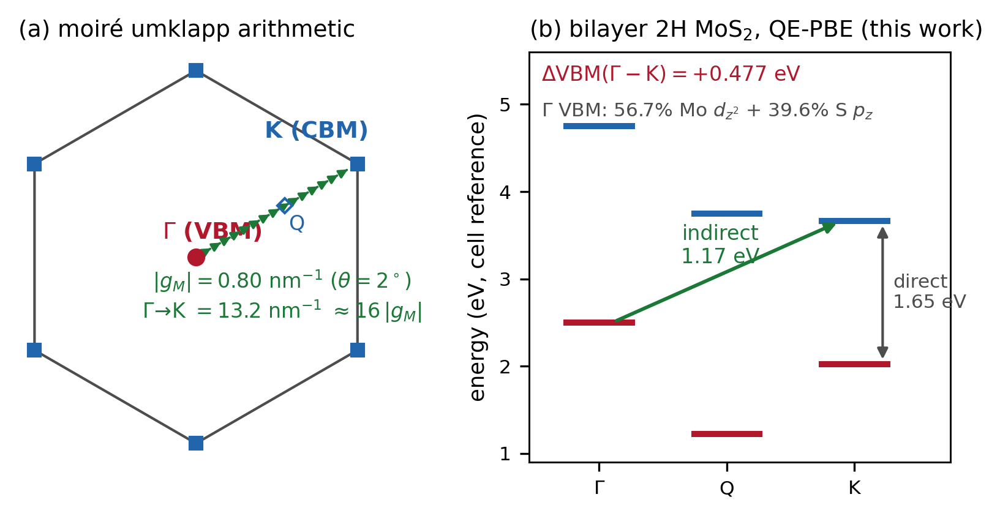
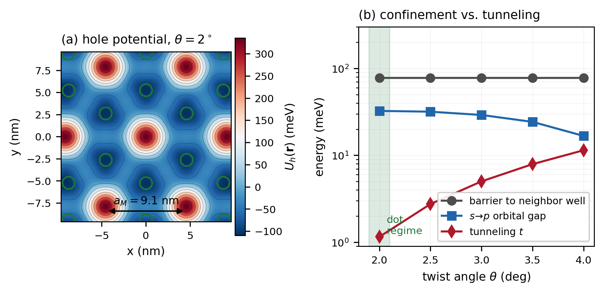
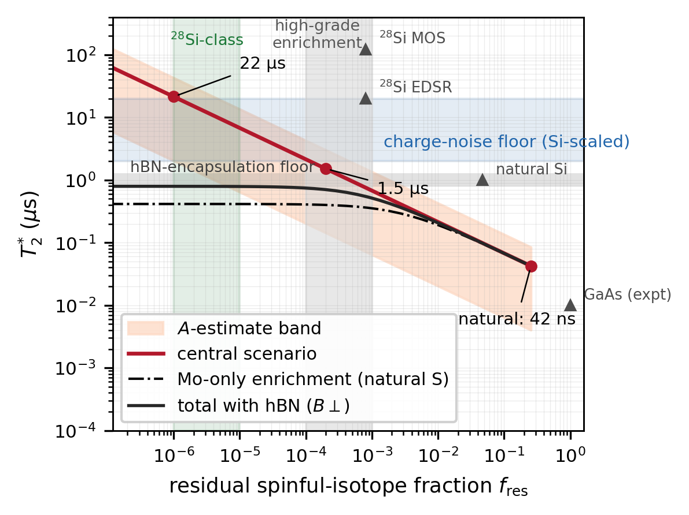
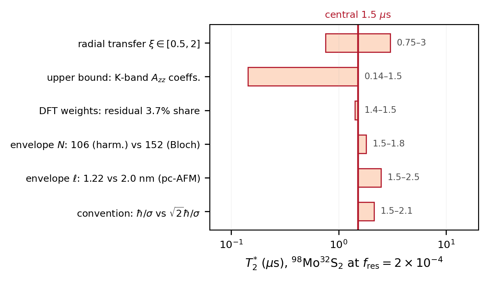

# Twisted bilayer MoS2: a Γ-valley hole spin memory and its isotope-purification coherence budget

**Status:** Short paper: Preprint on alphaXiv, <https://www.alphaxiv.org/abs/2611.twisted-mos2-hole-spin-coherence> (PDF in [`paper/`](paper/)).
Long version ("Momentum-dark moiré excitons and an isotope-purification coherence budget for Γ-valley hole spins in twisted bilayer MoS2"): Manuscript in preparation; extended abstract in [`paper/ABSTRACT.md`](paper/ABSTRACT.md).

## Question

Moiré superlattices place many identical quantum dots in one plane without lithography. Can twisted bilayer MoS2 host an optically addressed qubit, and if not, what is the carrier it does trap good for? This work shows that the lowest excitons are momentum-dark at every twist angle, identifies the Γ-valley hole as a valley-free, spin-orbit-free spin-1/2 in a natural moiré dot, and budgets its hyperfine-limited coherence T2* against isotope purification (98Mo, 32S) and hBN encapsulation.

## Method

- **Band character:** published DFT/continuum theory, momentum (umklapp) arithmetic, the photoluminescence record, and the author's own Quantum ESPRESSO PBE calculation of bilayer 2H-MoS2 (PAW, 12×12×1, a0 = 3.182 Å; inputs in `scripts/dft/`, outputs in `results/dft/`).
- **Moiré dot:** Γ-valley continuum potential (Angeli–MacDonald parametrization, V1,2,3 = 39.45/6.5/10.0 meV, ψ = π, m* = 0.9 m0) solved by plane-wave diagonalization (`scripts/t2_hesap.py`).
- **Coherence budget:** quasi-static Overhauser spread per nuclear bath, with published atomic hyperfine constants transferred to Γ through the DFT orbital weights; independent noise sources added in quadrature; through-space dipolar field of the hBN encapsulation nuclei.

## Key results (θ = 2°)



- **Dark by momentum:** bridging the Γ–K gap needs about 16 moiré reciprocal vectors at 2° (|ΓK| = 13.2 nm⁻¹, |g_M| = 0.80 nm⁻¹); interlayer tunneling supplies about one. Own DFT: the Γ VBM lies **+0.477 eV** above K; CBM at K (84 meV below Q); indirect gap 1.17 eV vs direct 1.65 eV. The Γ VBM is **56.7 % Mo d_z² + 39.6 % S p_z**.
- **Natural quantum dot:** a_M = 9.1 nm, barrier V1 − 8V2 + 9V3 = **77.4 meV**, ħω = 57.0 meV, envelope length ℓ = 1.219 nm, s–p gap 32 meV; the envelope covers N_Mo ≈ 106 and N_S ≈ 213 sites (about 320 nuclei). Tunneling t ≈ 1.2 meV at 2°.



- **Coherence budget** (central hyperfine estimate; optimistic–pessimistic band in brackets), from Table I of the published paper:

| system | f_spin | T2* |
|---|---|---|
| natural MoS2 | 0.255 | 42 ns [4–85] |
| standard 99.5 % 98Mo stock, MoS2 bath | 1.7×10⁻³ | 0.52 µs |
| same + hBN | 1.7×10⁻³ | 0.44–0.48 µs |
| 98Mo32S2, MoS2 bath | 2×10⁻⁴ | 1.5 µs [0.14–3.0] |
| same, f_res = 10⁻⁵ / 10⁻⁶ | 10⁻⁵ / 10⁻⁶ | 7 / 22 µs |
| hBN encapsulation alone (B⊥ / in-plane field) | — | 0.79 / 1.3 µs |
| 98Mo32S2 + hBN (B⊥ / in-plane field) | 2×10⁻⁴ | 0.70 / 0.98 µs |
| GaAs probe test (same formula) | 1 | 6.5 ns (measured ≈10 ns) |



- **Testable prediction:** a Ramsey ratio T2*(enriched)/T2*(natural) ≈ **17 (B⊥) to 23 (in-plane field)** at f_res = 2×10⁻⁴ with hBN, and 10–11 for standard 99.5 % stock. Against the MoS2 bath alone the gain √(f_nat/f_res) ≈ 36 at 2×10⁻⁴ contains no estimated number.



## Negative and limiting results

- Twisted bilayer MoS2 is **ruled out as an optical qubit**: its lowest excitons cannot emit light at any twist angle (it still absorbs at higher energy through the direct K–K transition).
- In **natural** material the small dot hurts: T2* ≈ 42 ns, because nuclear noise grows as 1/√N.
- Enriching **Mo alone** (natural S) caps T2* at about 0.4 µs; 32S purification is also required.
- **hBN sets the floor:** B and N have no spin-zero isotope, so a highly enriched, hBN-encapsulated device reaches only 0.7–1.0 µs (natural-silicon level). Going further requires a spinless spacer between the bilayer and the hBN.
- The Γ-valley hyperfine constant is **not computed directly**: a GIPAW calculation did not run (no gipaw.x in the conda build used, no Mo GIPAW pseudopotential found), so published K-valley atomic constants were transferred via DFT orbital weights. The deliberately pessimistic case (full K-valence couplings) gives 0.14 µs at 2×10⁻⁴. Absolute T2* is trusted to within a factor of 2.
- Charge noise and T1 have not been measured in any TMD dot; the 2–20 µs charge-noise floor is scaled from silicon and the long T1 is an inference.
- Superexchange between neighbouring occupied sites (J ≈ 49 µeV for the bare 2° bond, Hund–Mulliken estimate) means neighbouring memory cells must be left empty or the exchange suppressed; the budget is for a single hole.

## How the results were verified

- **Probe test:** the same Overhauser formula applied to a lateral GaAs dot gives 6.5 ns against ≈10 ns measured.
- **Closed forms:** well extrema, barrier (77.4 meV) and curvature (ħω = 57.0 meV) have closed-form expressions checked against the numerical diagonalization (`results/preprint_sayilar.json`, keys `kapali_formlar`, `well_2deg`).
- **hBN floor** cross-checked against an independent implementation (2°, B⊥: 0.794 µs in both).
- **Regeneration check (2026-11-15):** re-running `scripts/dft/analiz_dft.py` on the stored QE outputs reproduces `results/dft/dft_sonuc.json` exactly, and re-running `scripts/fig_uret.py` reproduces every value in `results/preprint_sayilar.json` exactly.
- **Sensitivity analysis** over six model choices (Fig. 4): the radial-transfer factor ξ ∈ [0.5, 2] dominates (0.75–3 µs around the 1.5 µs central value).

## Repository layout

- `paper/`: published short preprint (PDF) and extended abstract of the long version.
- `figures/`: Figs. 1–4 (PDF + PNG).
- `results/`: `preprint_sayilar.json` (every number behind the figures), `hyperfine_kiyas_tablosu.csv` (budget table), `dft/` (QE outputs and parsed band edges/orbital weights).
- `scripts/`: `t2_hesap.py` (continuum + hyperfine pipeline), `fig_uret.py` (figures + numbers), `dft/` (QE inputs, run scripts, parser).
- `docs/tr/bant_karakteri_karari.md`: original band-character decision note (Turkish).

Code comments and some variable names are in Turkish.

## Reproducing

```bash
pip install -r requirements.txt
python scripts/fig_uret.py          # run from repo root: figures/ + results/preprint_sayilar.json
python scripts/t2_hesap.py          # full continuum + hyperfine pipeline printout (slow, a few minutes)
python scripts/dft/analiz_dft.py    # band edges + orbital weights from results/dft/*.out
# DFT itself (optional, Quantum ESPRESSO 7.x): bash scripts/dft/setup.sh && bash scripts/dft/run_all.sh
```

## Related work by the author

- Twisted hBN artificial atoms, registry DFT: <https://doi.org/10.5281/zenodo.24201814> (alphaXiv: <https://www.alphaxiv.org/abs/2611.twisted-hbn-artificial-atoms-registry-dft>)
- Moiré microwave loss: <https://doi.org/10.5281/zenodo.24204124>
- josim-cpr-bridge: <https://github.com/FarukSamiBilgin/josim-cpr-bridge>

## Citation

Faruk Sami Bilgin (Independent Researcher, ORCID [0009-0001-9064-4410](https://orcid.org/0009-0001-9064-4410)).

```bibtex
@misc{bilgin2026tmos2,
  author = {Bilgin, Faruk Sami},
  title  = {Twisted bilayer MoS2 cannot talk to light: a Gamma-valley hole spin memory and its isotope-purification coherence budget},
  year   = {2026},
  note   = {alphaXiv preprint},
  url    = {https://www.alphaxiv.org/abs/2611.twisted-mos2-hole-spin-coherence}
}
```

AI assistance: AI coding assistants were used for code development and for adversarial review. All load-bearing results were re-derived by independent methods and checked by automated tests; the author is responsible for every claim.

## License

Code: MIT ([LICENSE](LICENSE)). Text, figures and data: CC BY 4.0 ([LICENSE-CONTENT](LICENSE-CONTENT)).
